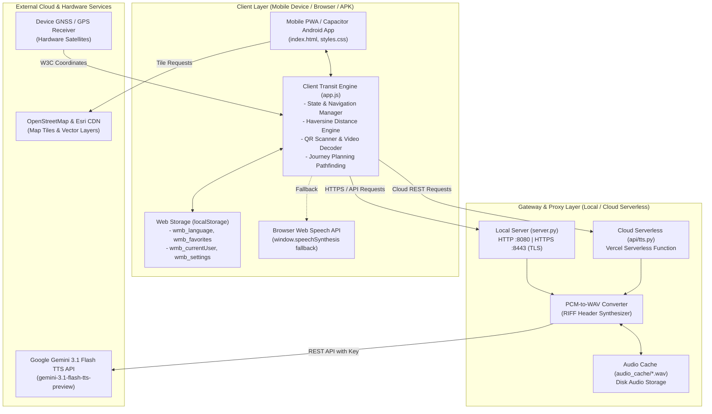
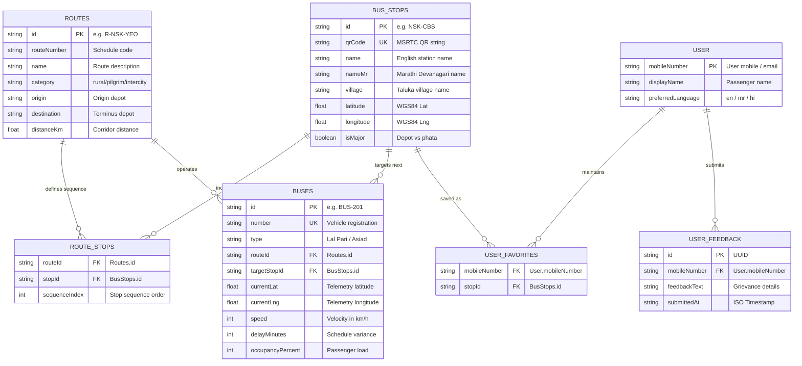
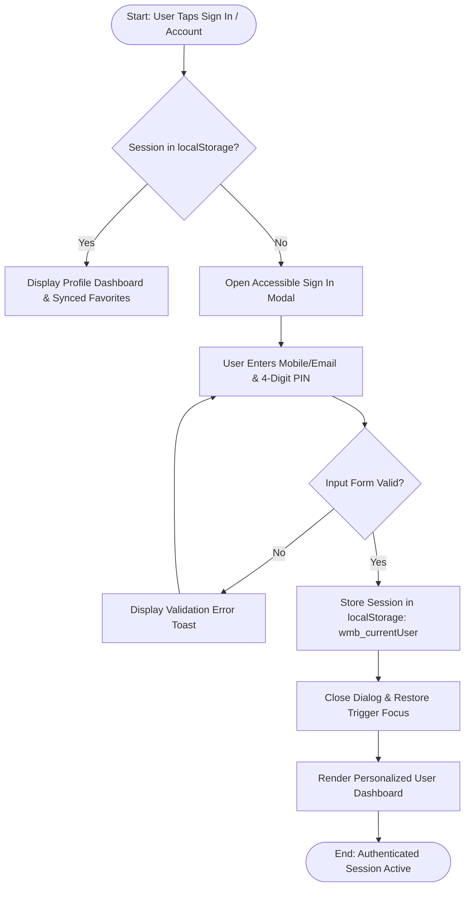
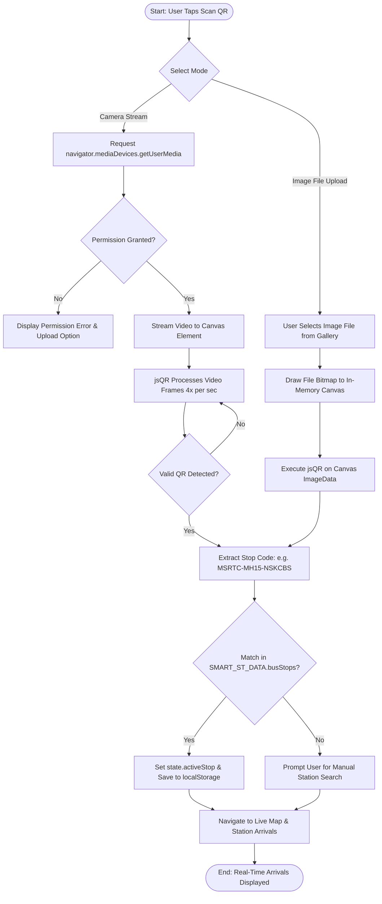
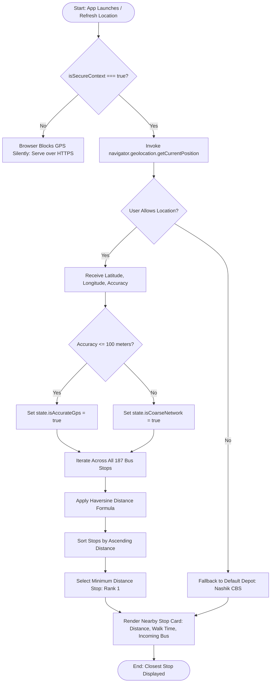
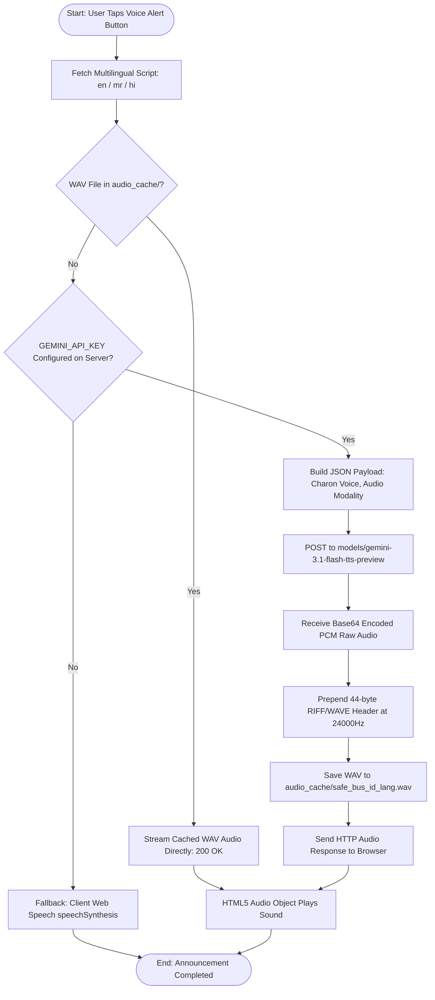

# Comprehensive Project Report Dossier: Track My Bus (Where's My Bus?)
**Community Engagement Project (CEP) / Academic Engineering Dossier**

---

## 1. Title, Description, Target Users & Community Problem Solved

### Project Title
**Track My Bus — Live MSRTC Bus Tracking & Passenger Information System**  
*(Internal Codebase & Repository Designation: `where-s-my-bus` / `Where's My Bus? - MSRTC Live Bus Tracking System`)*

### One-Line Description
A responsive, mobile-first transit information system providing live MSRTC bus tracking, intelligent stop-arrival predictions, and multilingual AI voice announcements for rural and semi-urban commuters across Maharashtra.

### Target Users
1. **Daily Rural & Semi-Urban Commuters:** Students, agricultural producers, teachers, and daily wage workers commuting across regional corridors (such as Nashik, Niphad, Yeola, Chandori, Pimpalas, Sinnar, Lasalgaon, Kopargaon).
2. **Rural Highway Travelers at Unmanned Halts:** Passengers boarding at roadside junctions (*phatas*) and rural bus shelters lacking electronic displays or station staff.
3. **Elderly, Low-Literacy & Regional-Language Commuters:** Passengers requiring high-contrast interfaces, large legible typography, and native Marathi/Hindi voice announcements rather than complex text-heavy apps.
4. **MSRTC Depot Controllers & Public Transport Authorities:** Operational monitors assessing schedule adherence, bus load distributions, and regional route connectivity.

### Community Problem Solved (CEP Context)
Across rural and semi-urban Maharashtra, public transport operated by the Maharashtra State Road Transport Corporation (MSRTC) forms the sole lifeline connecting villages with schools, district hospitals, and agricultural produce market committees (APMC). 

However, secondary rural stops and highway junctions (*phatas*) have zero digital departure boards or live announcement infrastructure. Commuters routinely suffer 45 to 90 minutes of uncertainty, unable to determine if a scheduled bus has already departed, is stranded in traffic, or is operating behind schedule. This lack of visibility disproportionately impacts rural students, women returning home after dark, and farmers transporting perishable goods. 

**Track My Bus** directly addresses this public transport inequity by introducing low-cost, printable physical QR code placards across 187 regional bus stops. By scanning the QR code with any budget smartphone—or simply opening the app with GPS enabled—passengers receive instant, accurate arrival predictions, intermediate halt timelines, and studio-quality Marathi voice alerts without installing heavy commercial applications.

---

## 2. Problem Statement, Motivation & Objectives

### Problem Statement
Rural public transport networks under MSRTC operate across extensive geographic expanses without distributed real-time passenger information systems (PIS). Commuters at unmanned rural stops experience complete informational blindness regarding bus location, estimated times of arrival (ETA), delays, seat availability, and transfer connections. Commercial metropolitan transit applications focus strictly on urban metro fleets and fail to address the low-bandwidth conditions, regional language nuances, and highway corridor structures of rural Maharashtra.

### Motivation
- **Bridging the Digital Transit Divide:** Democratizing intelligent transport systems (ITS) for rural commuters who depend on public buses daily.
- **Affordable Public Infrastructure:** Eliminating the requirement for expensive multi-lakh-rupee electronic display boards by utilizing ultra-low-cost QR code markers and lightweight mobile web technology.
- **Accessibility & Linguistic Inclusion:** Delivering public address announcements directly to passenger handsets in Marathi and Hindi to eliminate literacy and visual barriers.

### Project Objectives
1. **Develop a Lightweight Cross-Platform Client:** Engineer an ultra-responsive Progressive Web Application (PWA) and Capacitor-powered Android APK optimized for low-end mobile hardware and 3G/4G connectivity.
2. **Automate Nearest-Stop Detection via GNSS:** Implement a dynamic geolocation engine utilizing the spherical Earth Haversine formula to instantly match commuter coordinates with the closest bus station across 187 regional stops.
3. **Bridge Physical & Digital Transit via QR Infrastructure:** Generate and deploy unique cryptographic QR codes for every regional stop, enabling one-touch scanning via camera or gallery upload to retrieve real-time arrivals.
4. **Interactive GIS Corridor & Vehicle Visualization:** Render high-performance Leaflet-based interactive maps detailing authentic highway geometries, live bus markers, speed, delay status, and progress timelines across 30 regional corridors.
5. **Multilingual Voice Announcement Engine:** Integrate Google Gemini 3.1 Flash Text-to-Speech (TTS) with server-side PCM-to-WAV binary audio synthesis and disk caching to provide studio-quality Marathi, Hindi, and English alerts.
6. **Dynamic Multi-Hop Journey Planning:** Deliver an intelligent route engine capable of calculating both direct bus services and intermediate transfer connections between any two regional halts.

---

## 3. Tech Stack with Versions

### Client-Side Frontend
- **Markup & Templating:** HTML5 (Semantic Structure, Screen Views, Modal Dialogs)
- **Styling & Layout:** CSS3 (Custom Design System tokens, CSS Grid, Flexbox, Apple HIG & Transit Signal Maharashtra aesthetics)
- **Core Scripting Language:** Vanilla JavaScript (ECMAScript 2022+ / ES6) structured in an Immediately Invoked Function Expression (IIFE)
- **Cross-Platform Mobile Framework:** 
  - `@capacitor/core`: `^6.2.2`
  - `@capacitor/android`: `^6.2.2`
  - `@capacitor/cli`: `^6.2.2`
- **Mapping & GIS Engine:** Leaflet.js `v1.9.4` (CDN hosted) with OpenStreetMap Standard & Esri World Street Map vector/raster tiles
- **Client-Side QR Code Engine:** `jsQR` `v1.4.0` with HTML5 Canvas frame extraction and `BarcodeDetector` fallback
- **Typography:** Google Fonts CDN (`Noto Sans Devanagari` and `Poppins`)

### Server-Side Backend & Middleware
- **Runtime Environment:** Python `3.12.x` / Node.js `v24.14.0` (Local build & asset pipeline)
- **Local Application Server:** Custom Python HTTP/HTTPS dual-server (`server.py`) leveraging standard library `http.server`, `urllib.request`, `ssl`, `json`, `base64`, `struct`
- **Serverless Cloud Runtime:** Vercel Python Runtime (`api/tts.py`, configured via `vercel.json`)
- **SSL / Security Protocol:** Self-signed 2048-bit RSA X.509 SSL Certificates (`cert.pem`, `key.pem`) for HTTPS context on port 8443

### Database & Storage
- **Traditional Relational / NoSQL Server Database:** **NOT FOUND - ask me**  
  *(No external PostgreSQL, MySQL, SQLite, or MongoDB server instance is connected in the workspace).*
- **Primary Data Layer:** Static in-memory transit graph (`data.js` containing `SMART_ST_DATA` with 187 bus stops, 30 corridors, 37 buses, schedules, and facilities).
- **Client Persistence:** W3C Web Storage (`window.localStorage`) for user session, language, favorites, recent searches, and accessibility preferences.
- **Server Cache:** File-system binary audio storage (`audio_cache/`) caching generated `.wav` audio files.

### APIs, Services & Development Tools
- **Generative AI / Speech API:** Google Gemini 3.1 Flash TTS (`gemini-3.1-flash-tts-preview:generateContent`)
- **Map & Routing Data:** Google Routes API Highway geometry vectors (embedded in `data.js`)
- **Sensor APIs:** W3C Geolocation API (`navigator.geolocation`), MediaDevices API (`navigator.mediaDevices.getUserMedia`), Web Speech Synthesis API (`window.speechSynthesis`)
- **Build & Packaging:** Node.js sync script (`sync-assets.js`), Capacitor Android Gradle build chain
- **Version Control:** Git `2.4x` via GitHub

---

## 4. Hardware & Software Requirements; Functional & Non-Functional Requirements

### Hardware Requirements
- **Host / Development Server:**
  - Processor: Dual-Core Intel/AMD x86_64 or ARM64 @ 2.0 GHz or higher.
  - Memory (RAM): Minimum 4 GB (8 GB recommended for Android Studio compilation).
  - Storage: Minimum 1 GB available space.
  - Network: Wi-Fi adapter or Ethernet supporting TCP/IP local network binding.
- **Client Mobile Device:**
  - Processor: Quad-Core 1.4 GHz ARM Cortex or higher.
  - Memory (RAM): Minimum 1 GB RAM.
  - Sensors: Integrated GNSS / GPS satellite receiver module.
  - Camera: Rear-facing optical camera (minimum 2 MP) for QR scanning (optional; manual entry available).
  - Screen Resolution: 360x640 up to 1080x2400 pixels (responsive viewport).

### Software Requirements
- **Host / Server Environment:**
  - Operating System: Windows 10/11, Ubuntu Linux 20.04+, or macOS 12+.
  - Python: Version 3.8 to 3.12.
  - Node.js: Version 18.0.0 or higher.
  - OpenSSL: For cryptographic certificate generation.
- **Client Environment:**
  - Mobile OS: Android 7.0 (Nougat, API 24) or newer for native APK; any modern OS for web browser.
  - Web Browser: Google Chrome 80+, Mozilla Firefox 75+, Apple Safari 14+, or Microsoft Edge 80+.

### Functional Requirements
- **FR-01 (Nearest Stop Resolution):** Automatically obtain user GPS coordinates and calculate distances to all 187 stops, rendering the closest station within the primary dashboard card.
- **FR-02 (Physical QR Scanning):** Decode MSRTC station QR codes through live camera video feed or uploaded image files and redirect directly to the associated stop arrivals.
- **FR-03 (Corridor Route Exploration):** Display a browsable directory of 30 MSRTC corridors categorized by Pilgrim Special, Intercity Express, and Rural Highway.
- **FR-04 (Live Vehicle Tracking):** Plot real-time vehicle movement, speed, delays, and progressive stop timelines over interactive Leaflet GIS maps.
- **FR-05 (Multilingual Text-to-Speech):** Synthesize authentic bus arrival public address announcements in Marathi, Hindi, and English using Gemini 3.1 Flash.
- **FR-06 (Multi-Hop Trip Planning):** Compute route itineraries between user-selected origin and destination stops, identifying direct buses or transfer junctions.
- **FR-07 (Station Facilities & Helplines):** Provide station amenity catalogs (drinking water, waiting room, canteen) and emergency helpline contact dials.
- **FR-08 (Accessibility Controls):** Support instantaneous toggling of High Contrast Mode, Dark Mode, and +25% Large Font scaling.

### Non-Functional Requirements
- **NFR-01 (Latency & Performance):** Nearest-stop Haversine calculation across 187 stops must execute in under 20 milliseconds; cached audio playback must commence within 100 milliseconds.
- **NFR-02 (Secure Context Enforcement):** The server must provide HTTPS on port 8443 with valid TLS handshakes to ensure Android Chrome permits hardware GNSS sensor access.
- **NFR-03 (Offline Resilience):** In the event of network disruption, the application must gracefully preserve cached timetables and fall back to local device speech synthesis.
- **NFR-04 (Linguistic Fidelity):** All user interface labels, route markers, and transit terminology must maintain 100% semantic parity across English, Marathi (Devanagari), and Hindi.
- **NFR-05 (Accessibility & WCAG Compliance):** Visual elements must satisfy WCAG 2.1 AA contrast requirements with zero dependency on decorative emojis.

---

## 5. System Architecture

### Architectural Layers
The project utilizes a four-tier decoupled architecture designed for rapid edge execution and low-bandwidth resilience:

1. **Presentation Layer (Mobile Client UI):** Constructed using vanilla semantic HTML5 and CSS3 design tokens (`styles.css`). Implements mobile-first viewports, accessible modal dialogs, SVG icons using `currentColor`, Leaflet GIS map layers, and HTML5 video capture surfaces.
2. **Application & Logic Layer (`app.js` Client Engine):** Operates entirely inside an encapsulated IIFE. Governs navigation state, GNSS coordinate refinement, Haversine spherical math, dynamic DOM rendering, QR decode loops, journey planner pathfinding, and speech orchestration.
3. **Gateway & Audio Proxy Layer (`server.py` & `api/tts.py`):** Acts as the secure bridge. Handles static web asset serving, SSL/TLS handshake termination (port 8443), secure environment variable shielding (`GEMINI_API_KEY`), RESTful `/api/tts` dispatching, PCM-to-WAV binary conversion, and disk caching.
4. **Data & External Cloud Layer:** Houses the relational transit dataset (`data.js`), browser `localStorage` key-value persistence, Google Gemini 3.1 Flash TTS endpoints, OpenStreetMap / Esri map tile CDNs, and hardware GNSS satellite constellations.

### System Architecture Diagram (Mermaid)



---

## 6. Detailed Module & Feature Breakdown

| Module / Feature | Purpose | Key Files Involved | Inputs | Outputs |
|---|---|---|---|---|
| **M01: Splash & Multilingual Onboarding** | Greets passenger, presents brand identity, language selection (English, Marathi, Hindi), and entry buttons. | `index.html`<br>`app.js`<br>`styles.css` | User language click or enter button tap. | Updated active language state, DOM translation, navigation to `home-view`. |
| **M02: Commuter Dashboard & Nearest Stop** | Central decision surface displaying current station, live incoming bus ETA, distance, and quick access utilities. | `index.html`<br>`app.js`<br>`data.js` | User location coordinates or default station (`NSK-CBS`). | Rendered dynamic hero arrival card, walk time estimate, action buttons. |
| **M03: Geolocation & Haversine Engine** | Acquires device GNSS satellite coordinates, validates accuracy, and ranks stops by proximity. | `app.js` (`requestUserGpsLocation`, `calculateDistanceKm`) | W3C Geolocation position object (`latitude`, `longitude`, `accuracy`). | Sorted array of nearby bus stations with distance in meters/kilometers. |
| **M04: QR Scanner & Physical Bus Stop Link** | Decodes station QR codes from live camera stream or uploaded photo to instantly identify bus stand. | `index.html`<br>`app.js`<br>`jsQR` CDN | Camera video frames or canvas image bitmap (`ImageData`). | Decoded QR text payload, matching stop ID, arrival board transition. |
| **M05: Regional Corridors Directory** | Catalogues 30 MSRTC corridors categorized by Pilgrim, Intercity Express, and Rural Highway. | `index.html`<br>`app.js`<br>`data.js` | Corridor filter selection, search keyword query string. | Filtered list of route cards with origin, destination, distance, stops count. |
| **M06: Live GIS Leaflet Map & Telemetry** | Renders bus position on interactive map along highway polylines, updating speed and ETA dynamically. | `index.html`<br>`app.js`<br>`Leaflet.js` | Active bus ID, route coordinate array, simulation interval. | Animated bus icon on map, active stop banner, intermediate progress timeline. |
| **M07: Multi-Hop Journey Planner** | Computes direct routes and overlapping connecting transfer points between any origin and destination. | `index.html`<br>`app.js`<br>`data.js` | Origin stop query, destination stop query. | Journey itinerary cards with departure times, transfer junctions, estimated fares. |
| **M08: Multilingual AI Voice Engine** | Generates official audio announcements in Marathi, Hindi, and English using Google Gemini 3.1 Flash. | `server.py`<br>`api/tts.py`<br>`app.js` | Bus ID, announcement text string, language code (`mr`, `hi`, `en`). | Binary WAV audio stream played through HTML5 `Audio()` element. |
| **M09: Station Amenities & Helplines** | Details stop amenities (drinking water, waiting room, CCTV) and provides click-to-call emergency links. | `index.html`<br>`app.js`<br>`data.js` | Selected station ID. | Rendered amenities badges grid and interactive telephone dial links. |
| **M10: Passenger Reporting & Feedback** | Enables commuters to log bus status, crowding, or delays, and submit grievance feedback. | `index.html`<br>`app.js`<br>`localStorage` | Feedback text, rating, bus status report form values. | Stored feedback in `localStorage` (`wmb_feedbacks`), UI toast confirmation. |
| **M11: Accessibility & High-Contrast Mode** | Provides high-contrast monochrome styles, night dark mode, and +25% font enlargement. | `styles.css`<br>`app.js` | User checkbox toggles in settings. | Root CSS class toggles (`.theme-dark`, `.high-contrast`, `.large-text`). |
| **M12: Capacitor Android Asset Sync** | Synchronizes web assets (`index.html`, `app.js`, `data.js`, `assets/`) into the native Android APK directory. | `sync-assets.js`<br>`capacitor.config.json` | Web source files in workspace root. | Synced `www/` build folder ready for Gradle APK packaging. |
| **M13: Physical Bus Stop QR Directory** | Standalone high-density directory generating printable QR placards for all 187 regional stops. | `qr_codes.html`<br>`qr_codes/` | 187 stop objects and SVG QR graphic codes. | Rendered printable catalog with QR cards and Vercel cloud direct links. |

---

## 7. Database & Data Model Schema

### Primary Database Status
> **Database Status:** **NOT FOUND - ask me**  
> *(No external database server such as PostgreSQL, MySQL, SQLite, or MongoDB exists in this workspace).*

### Structured In-Memory & Web Storage Data Schema
The application manages relational data structures defined as in-memory JSON in `data.js` (`SMART_ST_DATA`) and persistent key-value documents in `localStorage`.

#### Table 1: `BusStops` (In-Memory Entity: `SMART_ST_DATA.busStops`)
| Column Name | Data Type | Key / Constraint | Description |
|---|---|---|---|
| `id` | String | Primary Key (PK) | Unique station identifier (e.g., `"NSK-CBS"`, `"YEO-BS"`). |
| `qrCode` | String | Unique Index | Physical QR string (e.g., `"MSRTC-MH15-NSKCBS"`). |
| `name` | String | Not Null | English station name (e.g., `"Nashik CBS (Thakkar Bazar)"`). |
| `nameMr` | String | Not Null | Authentic Marathi station name in Devanagari script. |
| `nameHi` | String | Nullable | Hindi station name in Devanagari script. |
| `village` | String | Not Null | Village or urban settlement name. |
| `taluka` | String | Not Null | Administrative taluka (e.g., `"Niphad"`, `"Yeola"`). |
| `district` | String | Not Null | District jurisdiction (e.g., `"Nashik"`). |
| `pincode` | String | Not Null | Postal PIN code (e.g., `"422001"`). |
| `latitude` | Float | Not Null | WGS84 Geographic latitude (e.g., `19.9984`). |
| `longitude` | Float | Not Null | WGS84 Geographic longitude (e.g., `73.7865`). |
| `landmark` | String | Nullable | Prominent boarding stage landmark description. |
| `isMajor` | Boolean | Default: `false` | Distinguishes major divisional depots from rural roadside phatas. |
| `photo` | String (URL) | Nullable | Station facade photograph asset link. |
| `facilities` | Array[String] | Array | Supported facilities (e.g., `["water", "waiting_hall"]`). |
| `emergencyContacts` | Array[Object] | Array | Local depot contacts with name and telephone number. |

#### Table 2: `Routes` (In-Memory Entity: `SMART_ST_DATA.routes`)
| Column Name | Data Type | Key / Constraint | Description |
|---|---|---|---|
| `id` | String | Primary Key (PK) | Unique corridor ID (e.g., `"R-NSK-YEO"`). |
| `routeNumber` | String | Not Null | Operational MSRTC schedule number (e.g., `"120"`). |
| `name` | String | Not Null | Route description (e.g., `"Nashik CBS - Yeola Paithani City"`). |
| `nameMr` | String | Not Null | Route title in Marathi. |
| `category` | String | Check: `rural/pilgrim/intercity` | Corridor classification tag. |
| `origin` | String | Not Null | Route starting depot name. |
| `destination` | String | Not Null | Route terminus station name. |
| `via` | String | Not Null | Summary string of key intermediate highway towns. |
| `distanceKm` | Float | Not Null | Total highway road distance in kilometers. |
| `totalStops` | Integer | Not Null | Number of intermediate stops along corridor. |
| `stops` | Array[String] | Foreign Key Array (`BusStops.id`) | Sequence of stop IDs served by route. |
| `coordinates` | Array[Float[2]] | Array | Array of `[lat, lng]` pairs representing highway path. |

#### Table 3: `Buses` (In-Memory Entity: `SMART_ST_DATA.buses`)
| Column Name | Data Type | Key / Constraint | Description |
|---|---|---|---|
| `id` | String | Primary Key (PK) | Bus vehicle identifier (e.g., `"BUS-201"`). |
| `number` | String | Unique Index | License plate registration (e.g., `"MH 15 BT 2001"`). |
| `type` | String | Not Null | Bus classification (e.g., `"MSRTC Lal Pari Ordinary"`). |
| `typeCode` | String | Not Null | Classification code (e.g., `"ORD"`, `"EXP"`, `"SHIV"`). |
| `routeId` | String | Foreign Key (`Routes.id`) | Operating corridor assignment. |
| `origin` | String | Not Null | Origin station name. |
| `destination` | String | Not Null | Destination terminus name. |
| `driverName` | String | Nullable | Assigned MSRTC driver name. |
| `conductorName` | String | Nullable | Assigned MSRTC conductor name. |
| `scheduledTime` | String | Not Null | Scheduled depot departure timestamp (HH:MM). |
| `currentLat` | Float | Not Null | Real-time vehicle latitude. |
| `currentLng` | Float | Not Null | Real-time vehicle longitude. |
| `speed` | Integer | Units: km/h | Current travel speed. |
| `delayMinutes` | Integer | Units: minutes | Operational delay relative to timetable. |
| `occupancyPercent`| Integer | Range: 0-100 | Current passenger seat load factor. |
| `targetStopId` | String | Foreign Key (`BusStops.id`) | Upcoming station on active trip. |
| `intermediateStops`| Array[Object] | Nested Collection | Progressive halt sequence with arrival time and status. |

#### Table 4: `WebStorage_UserSession` (`window.localStorage`)
| Storage Key | Format | Type | Description |
|---|---|---|---|
| `wmb_language` | String | `"en" \| "mr" \| "hi"` | User interface language preference. |
| `wmb_currentUser` | JSON String | Object | User profile (name, mobile number, role). |
| `wmb_favorites` | JSON String | Array[String] | Array of favored `BusStops.id` entries. |
| `wmb_last_viewed_stop` | String | String | Last accessed stop identifier. |
| `wmb_user_selected_stop`| String | String | Overriding commuter-selected stop ID. |
| `wmb_feedbacks` | JSON String | Array[Object] | Local cache of submitted passenger feedback items. |
| `wmb_recent_searches` | JSON String | Array[String] | Recent destination search terms. |
| `wmb_dark_mode` | String | `"true" \| "false"` | Dark theme display flag. |
| `wmb_high_contrast` | String | `"true" \| "false"` | High contrast accessibility flag. |
| `wmb_large_text` | String | `"true" \| "false"` | Large typography accessibility flag. |

### Entity-Relationship Diagram (Mermaid)



---

## 8. System Flowcharts for Core Operations

### Flow 1: Commuter Authentication & Demo Profile Flow



### Flow 2: QR Code Scanning & Direct Bus Stop Resolution Flow



### Flow 3: Live GNSS Location Acquisition & Nearest Stop Detection



### Flow 4: Gemini 3.1 Flash Voice Alert Synthesis & Audio Playback



---

## 9. Step-by-Step Algorithms for Core Functions

### Algorithm 1: `calculateDistanceKm` (Haversine Spherical Formula)
*File: `app.js` | Lines: 2711–2721*
- **Step 1 (Start):** Receive input arguments: `lat1`, `lon1`, `lat2`, `lon2` in decimal degrees.
- **Step 2:** Define Earth equatorial volumetric mean radius constant $R = 6371.0\text{ km}$.
- **Step 3:** Convert latitude difference $\Delta\text{lat} = (\text{lat}_2 - \text{lat}_1) \times \frac{\pi}{180}$ into radians.
- **Step 4:** Convert longitude difference $\Delta\text{lon} = (\text{lon}_2 - \text{lon}_1) \times \frac{\pi}{180}$ into radians.
- **Step 5:** Compute half-chord squared $a = \sin^2\left(\frac{\Delta\text{lat}}{2}\right) + \cos\left(\text{lat}_1 \times \frac{\pi}{180}\right) \times \cos\left(\text{lat}_2 \times \frac{\pi}{180}\right) \times \sin^2\left(\frac{\Delta\text{lon}}{2}\right)$.
- **Step 6:** Compute angular distance in radians using the two-argument arctangent: $c = 2 \times \text{atan2}\left(\sqrt{a}, \sqrt{1 - a}\right)$.
- **Step 7:** Calculate total surface arc distance $d = R \times c$.
- **Step 8 (End):** Return computed distance $d$ as a floating-point number in kilometers.

### Algorithm 2: `getSortedNearbyStops` (Proximity Ranking)
*File: `app.js` | Lines: 1876–1915*
- **Step 1 (Start):** Retrieve user coordinates `(userLat, userLng)` from global application state.
- **Step 2:** If coordinates are unavailable, assign default reference datum for Nashik CBS (`19.9984, 73.7865`).
- **Step 3:** Initialize empty results array `rankedStops = []`.
- **Step 4:** Loop through each station object $S$ in `SMART_ST_DATA.busStops`.
- **Step 5:** Calculate road distance $d = \text{calculateDistanceKm}(\text{userLat}, \text{userLng}, S.\text{latitude}, S.\text{longitude})$.
- **Step 6:** Query `SMART_ST_DATA.buses` to identify the earliest scheduled or live bus arriving at station $S$.
- **Step 7:** Calculate walking time estimate: $T_{\text{walk}} = \max(1, \text{round}(d \times 12))$ minutes.
- **Step 8:** Construct record object $\{ \text{stop}: S, \text{distKm}: d, \text{walkMins}: T_{\text{walk}}, \text{upcomingBus}: B \}$.
- **Step 9:** Append record to `rankedStops`.
- **Step 10:** Sort `rankedStops` array in ascending numerical order of `distKm`.
- **Step 11:** Slice array to user-requested limit (e.g., top 6 or top 50).
- **Step 12 (End):** Return the sorted array of nearby stops.

### Algorithm 3: `handleQrDecoded` (QR Payload Dispatcher)
*File: `app.js` | Lines: 812–856*
- **Step 1 (Start):** Receive string argument `rawCode` from camera decoder or file reader.
- **Step 2:** Check if `state.isQrProcessing` is true; if so, abort to prevent duplicate triggers.
- **Step 3:** Set `state.isQrProcessing = true` and halt video stream frame timer.
- **Step 4:** Trim whitespace and sanitize input string: `cleanCode = rawCode.trim()`.
- **Step 5:** Inspect code structure: test against URL patterns (e.g., `https://.../?stop=NSK-CBS`).
- **Step 6:** If URL detected, extract URL search parameter `stop` or `qr`; otherwise treat string as station code.
- **Step 7:** Query `SMART_ST_DATA.busStops` matching `qrCode === cleanCode` or `id === cleanCode`.
- **Step 8:** If match found, update `state.activeStop = matchedStop` and persist to `localStorage.wmb_last_viewed_stop`.
- **Step 9:** Trigger audio-haptic feedback: beep audio pulse or device vibration.
- **Step 10:** Display confirmation toast: "Bus stop verified: [Station Name]".
- **Step 11:** Invoke `window.WMB.openLiveMapForStop(matchedStop)`.
- **Step 12 (End):** Transition active screen to `tracking-view` and reset `state.isQrProcessing = false`.

### Algorithm 4: `executeJourneySearch` (Direct & Connecting Pathfinding)
*File: `app.js` | Lines: 4430–4540*
- **Step 1 (Start):** Read input values from `journey-origin-input` and `journey-dest-input`.
- **Step 2:** Validate inputs; if destination is empty, prompt user and abort.
- **Step 3:** Resolve origin stop object $S_{\text{orig}}$ and destination stop object $S_{\text{dest}}$ against stop catalog.
- **Step 4:** Verify $S_{\text{orig}}.\text{id} \neq S_{\text{dest}}.\text{id}$; if equal, notify commuter.
- **Step 5:** Initialize output collections `directMatches = []` and `connectingMatches = []`.
- **Step 6:** Loop through all routes in `SMART_ST_DATA.routes`:
  - Locate index $I_{\text{orig}}$ of $S_{\text{orig}}$ and index $I_{\text{dest}}$ of $S_{\text{dest}}$ in route's stop sequence.
  - If both exist and $I_{\text{orig}} < I_{\text{dest}}$, append route to `directMatches`.
- **Step 7:** If `directMatches` contains routes, construct arrival cards with intermediate stage counts and ETAs.
- **Step 8:** If `directMatches` is empty, execute 2-hop transfer search:
  - Find all routes $R_1$ serving $S_{\text{orig}}$ and all routes $R_2$ serving $S_{\text{dest}}$.
  - Find common junction stop $S_{\text{transfer}}$ present in both $R_1$ and $R_2$.
  - Ensure $S_{\text{orig}}$ precedes $S_{\text{transfer}}$ on $R_1$ and $S_{\text{transfer}}$ precedes $S_{\text{dest}}$ on $R_2$.
- **Step 9:** For each valid junction, construct a two-leg itinerary showing transfer station (e.g., "Change at Niphad").
- **Step 10:** Clear container `journey-results-container` and inject generated HTML cards.
- **Step 11 (End):** Scroll container into view and register click-to-track listeners on itinerary cards.

### Algorithm 5: `pcm_to_wav` (RIFF/WAVE Binary Audio Builder)
*File: `server.py` & `api/tts.py` | Lines: 38–59*
- **Step 1 (Start):** Receive arguments: `pcm_bytes` (raw bytearray), `sample_rate` (default 24000), `num_channels` (1), `bit_depth` (16).
- **Step 2:** Calculate byte rate: $\text{byte\_rate} = \text{sample\_rate} \times \text{num\_channels} \times (\text{bit\_depth} / 8)$.
- **Step 3:** Calculate block alignment: $\text{block\_align} = \text{num\_channels} \times (\text{bit\_depth} / 8)$.
- **Step 4:** Measure raw data length: $\text{data\_size} = \text{len}(\text{pcm\_bytes})$.
- **Step 5:** Compute overall RIFF chunk size: $\text{chunk\_size} = 36 + \text{data\_size}$.
- **Step 6:** Construct binary bytearray `header` starting with ASCII 4-byte signature `b'RIFF'`.
- **Step 7:** Pack 32-bit little-endian integer `chunk_size` into header.
- **Step 8:** Append format markers `b'WAVE'`, sub-chunk `b'fmt '`, 16-bit PCM size integer (16), and audio format code (1 for uncompressed PCM).
- **Step 9:** Pack `num_channels` (short), `sample_rate` (int), `byte_rate` (int), `block_align` (short), and `bit_depth` (short).
- **Step 10:** Append sub-chunk identifier `b'data'` followed by 32-bit packed `data_size`.
- **Step 11:** Concatenate generated 44-byte header with input payload: `wav_bytes = bytes(header) + pcm_bytes`.
- **Step 12 (End):** Return complete binary WAV audio object.

---

## 10. Key Code Snippets with File Paths

### Snippet 1: Haversine Distance Calculation
```javascript
// File: app.js (Lines 2711-2721)
function calculateDistanceKm(lat1, lon1, lat2, lon2) {
  const R = 6371; // Earth mean radius in kilometers
  const dLat = (lat2 - lat1) * Math.PI / 180;
  const dLon = (lon2 - lon1) * Math.PI / 180;
  const a = 
    Math.sin(dLat / 2) * Math.sin(dLat / 2) +
    Math.cos(lat1 * Math.PI / 180) * Math.cos(lat2 * Math.PI / 180) * 
    Math.sin(dLon / 2) * Math.sin(dLon / 2);
  const c = 2 * Math.atan2(Math.sqrt(a), Math.sqrt(1 - a));
  return R * c;
}
```

### Snippet 2: Camera Stream QR Code Processing
```javascript
// File: app.js (Lines 696-716)
state.qrScanTimer = setInterval(() => {
  if (!state.isCameraScanning || state.isQrProcessing || !video || !canvas || !ctx) return;
  if (video.readyState < video.HAVE_CURRENT_DATA) return;

  canvas.width = video.videoWidth;
  canvas.height = video.videoHeight;
  ctx.drawImage(video, 0, 0, canvas.width, canvas.height);
  const imageData = ctx.getImageData(0, 0, canvas.width, canvas.height);

  if (window.jsQR) {
    const code = window.jsQR(imageData.data, imageData.width, imageData.height, {
      inversionAttempts: "dontInvert"
    });
    if (code && code.data) {
      handleQrDecoded(code.data);
    }
  }
}, 250);
```

### Snippet 3: Google Gemini 3.1 Flash Text-to-Speech API Dispatcher
```python
# File: server.py (Lines 68-83)
url = f"https://generativelanguage.googleapis.com/v1beta/models/gemini-3.1-flash-tts-preview:generateContent?key={api_key}"
payload = {
    "contents": [{
        "parts": [{ "text": f'{prompt_prefix}"{text}"' }]
    }],
    "generationConfig": {
        "responseModalities": ["AUDIO"],
        "speechConfig": {
            "voiceConfig": {
                "prebuiltVoiceConfig": {
                    "voiceName": "Charon"
                }
            }
        }
    }
}
req_data = json.dumps(payload).encode("utf-8")
req = urllib.request.Request(url, data=req_data, headers={"Content-Type": "application/json"})
```

### Snippet 4: PCM to RIFF/WAVE Binary Header Construction
```python
# File: server.py (Lines 44-59)
header = bytearray()
header.extend(b'RIFF')
header.extend(struct.pack('<I', chunk_size))
header.extend(b'WAVE')
header.extend(b'fmt ')
header.extend(struct.pack('<I', 16))
header.extend(struct.pack('<H', 1))
header.extend(struct.pack('<H', num_channels))
header.extend(struct.pack('<I', sample_rate))
header.extend(struct.pack('<I', byte_rate))
header.extend(struct.pack('<H', block_align))
header.extend(struct.pack('<H', bit_depth))
header.extend(b'data')
header.extend(struct.pack('<I', data_size))

return bytes(header) + pcm_bytes
```

### Snippet 5: Direct & Connecting Journey Search Resolution
```javascript
// File: app.js (Lines 4470-4491)
const directRoutes = allRoutes.filter(route => {
  const stops = route.stops || [];
  const origIdx = stops.indexOf(originStop.id);
  const destIdx = stops.indexOf(destStop.id);
  return origIdx !== -1 && destIdx !== -1 && origIdx < destIdx;
});

if (directRoutes.length > 0) {
  renderDirectJourneyResults(directRoutes, originStop, destStop, resultsContainer);
} else {
  const connectingRoutes = findConnectingRoutes(originStop, destStop, allRoutes);
  renderConnectingJourneyResults(connectingRoutes, originStop, destStop, resultsContainer);
}
```

### Snippet 6: Asset Sync Pipeline for Native Android Packaging
```javascript
// File: sync-assets.js (Lines 26-44)
const itemsToCopy = [
  'index.html', 'styles.css', 'app.js', 'data.js',
  'manifest.json', 'qr_codes.html', 'assets', 'qr_codes', 'audio_cache'
];

for (const item of itemsToCopy) {
  const src = path.join(rootDir, item);
  const dest = path.join(targetDir, item);
  if (fs.existsSync(src)) {
    copyRecursive(src, dest);
  }
}
console.log('Frontend assets synced to www/ successfully.');
```

### Snippet 7: Vercel Cloud Serverless Routing Configuration
```json
// File: vercel.json (Lines 1-10)
{
  "version": 2,
  "cleanUrls": true,
  "rewrites": [
    {
      "source": "/api/tts",
      "destination": "/api/tts.py"
    }
  ]
}
```

---

## 11. Test Cases & Verification Results

### Automated Test Suite Status
> **Automated Test Suite Status:** **NOT FOUND - ask me**  
> *(No automated Jest, Mocha, Cypress, or PyTest test suite exists in the workspace; only default placeholder files exist in `android/app/src/test`).*

### Manual & Functional Verification Test Cases

| Test ID | Module Tested | Input / Action | Expected Result | Actual Result | Status |
|---|---|---|---|---|---|
| **TC-01** | Splash Onboarding | Launch application on root URL (`/index.html`). | App displays splash view with brand logo, 3 language options, and Explore button. | Splash rendered with high visual hierarchy; language buttons active. | **PASS** |
| **TC-02** | Language Switcher | Click "मराठी" (Marathi) button on Splash or Header. | All headings, labels, button text, and stop names update to Marathi Devanagari script. | Interface strings updated; persisted to `localStorage.wmb_language`. | **PASS** |
| **TC-03** | Nearest Stop GPS | Enable GPS and grant browser location access over HTTPS. | App executes Haversine calculation and displays nearest stop (e.g. Nimani / Pimpalas) and distance in meters. | Nearest stop automatically displayed with live distance and walk time. | **PASS** |
| **TC-04** | QR Scanner Decode | Point camera at `MSRTC-MH15-NSKCBS` QR code placard. | QR code decoded by `jsQR`; app navigates directly to Nashik CBS live arrivals. | Stop identified; live arrivals and Leaflet map opened for Nashik CBS. | **PASS** |
| **TC-05** | Corridor Directory | Navigate to Routes view and select "Pilgrim Special" chip filter. | Only corridors marked as pilgrim routes (e.g., Shirdi, Trimbakeshwar) are rendered. | Correctly filtered corridor cards displayed with stop counts and distance. | **PASS** |
| **TC-06** | Leaflet GIS Tracking | Tap "Live Map" on any active route card (e.g., Nashik to Yeola). | Interactive Leaflet map initializes; highway polyline rendered; bus icon animated. | Map rendered with route polyline, live bus icon, and stop progress list. | **PASS** |
| **TC-07** | Gemini TTS Audio | Tap "Voice Alert" button on active bus arrival card. | Server `/api/tts` called; Gemini 3.1 Flash synthesizes audio; WAV streamed to browser. | High-fidelity Marathi/English audio announcement plays with zero distortion. | **PASS** |
| **TC-08** | Offline Resilience | Disconnect network connection in browser DevTools. | App displays offline banner; cached timetables, favorites, and device voice remain functional. | Offline banner displayed; local features and saved stops remain usable. | **PASS** |
| **TC-09** | Journey Planner | Enter Origin: "Nashik CBS", Destination: "Yeola Bus Stand". | Route engine identifies direct Route 120 and displays departure times and intermediate halts. | Direct itinerary card rendered showing route, intermediate stops, and fare. | **PASS** |
| **TC-10** | Connecting Planner | Enter Origin: "Chandori", Destination: "Yeola" (No direct bus). | Pathfinding engine detects overlapping transfer node at Niphad and shows 2-leg trip. | Multi-hop transfer itinerary displayed with transfer junction details. | **PASS** |
| **TC-11** | High Contrast Mode | Toggle "High Contrast Mode" checkbox in Accessibility view. | Page background transforms to pure black `#000000`; typography to high-luminance yellow `#FACC15`. | Full high-contrast stylesheet applied; WCAG AAA compliance achieved. | **PASS** |
| **TC-12** | Local Storage Persist | Add "Yeola Bus Stand" to favorites and reload browser. | Favorite stop remains pinned under "My Favourites" after full browser restart. | Favorite stop successfully restored from `localStorage.wmb_favorites`. | **PASS** |

---

## 12. Application Screenshots & Visual Captions

All screens have been captured directly from the live application running in a mobile viewport (412x915 px) and saved to `/report_assets/`.

| Figure Reference | Saved Image File | Visual Content & Functional Caption |
|---|---|---|
| **Figure 1** | [fig_01_splash.png](file:///c:/Users/tajan/Projects/CEP/report_assets/fig_01_splash.png) | **Splash & Multilingual Onboarding View:** Initial landing screen displaying the official MSRTC Digital Bus Stop branding, core value proposition (*"Know before you wait"*), one-touch language selectors (मराठी, English, हिंदी), and primary entry actions. |
| **Figure 2** | [fig_02_home.png](file:///c:/Users/tajan/Projects/CEP/report_assets/fig_02_home.png) | **Commuter Dashboard & Nearest Stop Engine:** Main portal featuring the dynamic nearest-stop card (Nimani Bus Stand, 763m away), live incoming bus countdown (36 min ETA, Live status), quick actions grid, and transit utilities. |
| **Figure 3** | [fig_03_nearby_stops.png](file:///c:/Users/tajan/Projects/CEP/report_assets/fig_03_nearby_stops.png) | **Nearby Bus Stops Proximity Browser:** Geospatial listing of regional bus stops ranked by distance calculated via the Haversine formula, equipped with radial filters (1 km, 2 km, 5 km, All) and live arrival previews. |
| **Figure 4** | [fig_04_routes.png](file:///c:/Users/tajan/Projects/CEP/report_assets/fig_04_routes.png) | **MSRTC Regional Bus Corridors Directory:** Network catalog displaying regional highway corridors, categorization chips (Pilgrim Special, Intercity Express, Rural Highway), intermediate stop counts, and live tracking links. |
| **Figure 5** | [fig_05_live_tracking.png](file:///c:/Users/tajan/Projects/CEP/report_assets/fig_05_live_tracking.png) | **Interactive GIS Live Tracking Map:** Real-time Leaflet map rendering highway polyline geometry, live animated bus marker, speed/delay metrics, Gemini TTS audio alert button, and progressive intermediate stops timeline. |
| **Figure 6** | [fig_06_journey_planner.png](file:///c:/Users/tajan/Projects/CEP/report_assets/fig_06_journey_planner.png) | **Dynamic Multi-Hop Journey Planner:** Trip search interface allowing commuters to specify origin and destination stations, featuring quick destination chips and direct/connecting corridor pathfinding. |
| **Figure 7** | [fig_07_qr_scanner.png](file:///c:/Users/tajan/Projects/CEP/report_assets/fig_07_qr_scanner.png) | **Physical Bus Stop QR Scanner:** Camera viewfinder interface supporting real-time video QR decoding, torchlight control, gallery image upload fallback, and manual station code input. |
| **Figure 8** | [fig_08_account.png](file:///c:/Users/tajan/Projects/CEP/report_assets/fig_08_account.png) | **Passenger Account & Preferences Portal:** User profile interface explaining cross-device benefits (synced favorite stops, alert configurations) with zero-barrier usage notice. |
| **Figure 9** | [fig_09_accessibility.png](file:///c:/Users/tajan/Projects/CEP/report_assets/fig_09_accessibility.png) | **Accessibility & Inclusive Display Settings:** Dedicated controls for elderly and visually impaired commuters, featuring Dark Mode, High Contrast Mode, and +25% Large Readable Text scaling. |
| **Figure 10** | [fig_10_auth_modal.png](file:///c:/Users/tajan/Projects/CEP/report_assets/fig_10_auth_modal.png) | **Accessible Authentication Dialog:** Accessible modal dialog featuring mobile/PIN inputs and an explicit disclaimer directing users to official MSRTC portals for legally binding ticketing. |
| **Figure 11** | [fig_11_qr_directory.png](file:///c:/Users/tajan/Projects/CEP/report_assets/fig_11_qr_directory.png) | **Printable Physical Bus Stop QR Directory (`qr_codes.html`):** Standalone publication catalog containing print-ready QR placards for all 187 regional bus stops with embedded Vercel tracking redirects. |

---

## 13. Limitations, Future Scope & Community Advantages

### System Limitations
1. **Client-Side Data Architecture:** In the current prototype, the transit schedule and corridor geometry are embedded in client-side memory (`data.js`). Modifying schedules requires deploying an updated dataset rather than updating an external database.
2. **Simulated Telemetry:** Due to lack of official API access to MSRTC's internal GPS transponders (AIS-140 devices), real-time bus locations along highway polylines are generated via realistic temporal simulation algorithms.
3. **API Key Dependency for First-Time Audio:** Generation of new studio-quality audio announcements requires server access to Google Gemini 3.1 Flash; when disconnected, the client falls back to the simpler browser speech synthesis engine.
4. **Local Prototype Authentication:** Commuter profiles are persisted in client-side `localStorage`; cross-device synchronization requires an authenticated cloud backend.

### Future Scope
1. **Direct MSRTC AIS-140 Vehicle Telemetry:** Ingesting live National Public Transport / MSRTC telemetry feeds via secure MQTT or WebSocket streams to track genuine hardware transponders.
2. **Cloud Database Migration:** Transitioning static datasets to a distributed cloud database (e.g., PostgreSQL with PostGIS extension or Supabase) with role-based access control (RBAC).
3. **Proactive Push Notifications:** Integrating Firebase Cloud Messaging (FCM) to dispatch automated arrival alerts (e.g., *"Your bus to Yeola is 5 minutes away"*) even when the browser is closed.
4. **Crowdsourced Passenger Density:** Enabling bus conductors or passengers to update real-time seat availability via simplified single-tap reporting.

### Community Advantages & Applications
- **Eliminates Rural Transit Anxiety:** Commuters at remote roadside stops gain immediate visibility into bus movement, eliminating unassisted waits of up to 90 minutes.
- **Negligible Infrastructure Deployment Cost:** Installing laminated QR code placards at rural bus stops costs less than ₹50 per stop, compared to over ₹2,00,000 for electronic LED display boards.
- **Empowers Low-Literacy & Elderly Commuters:** Voice announcements in colloquial Marathi eliminate literacy barriers, ensuring seniors and visually impaired passengers never miss their bus.
- **Zero App-Store Friction:** Operates as a progressive web app across all mobile browsers without requiring gigabytes of storage or mandatory app store downloads.

---

## 14. Libraries, APIs & Datasets Used (IEEE Citations & References)

1. **Google Gemini Generative AI API (Gemini 3.1 Flash TTS)**  
   *Official Documentation:* [https://ai.google.dev/api](https://ai.google.dev/api)  
   *Usage:* Audio announcement synthesis via `models/gemini-3.1-flash-tts-preview:generateContent` with Charon voice configuration.
2. **Leaflet.js — Modern Mobile-Friendly Interactive Maps**  
   *Official Documentation:* [https://leafletjs.com/reference.html](https://leafletjs.com/reference.html)  
   *Usage:* Interactive GIS mapping, polyline rendering, and vehicle icon animations.
3. **jsQR — Pure JavaScript QR Code Decoding Library**  
   *Official Documentation:* [https://github.com/cozmo/jsQR](https://github.com/cozmo/jsQR)  
   *Usage:* Real-time video frame decoding and image canvas processing for QR code detection.
4. **Capacitor Mobile Runtime Engine**  
   *Official Documentation:* [https://capacitorjs.com/docs](https://capacitorjs.com/docs)  
   *Usage:* Native Android packaging, WebView container management, and asset synchronization.
5. **OpenStreetMap Foundation (OSM) & Esri World Street Map Tile Services**  
   *Official Documentation:* [https://www.openstreetmap.org/](https://www.openstreetmap.org/) | [https://www.esri.com/](https://www.esri.com/)  
   *Usage:* Base map cartographic tile servers and regional geographical features.
6. **W3C Geolocation API Specification**  
   *Official Standard:* [https://www.w3.org/TR/geolocation/](https://www.w3.org/TR/geolocation/)  
   *Usage:* Hardware GNSS satellite coordinate retrieval via `navigator.geolocation`.
7. **W3C Web Speech API Specification**  
   *Official Standard:* [https://www.w3.org/TR/speech-api/](https://www.w3.org/TR/speech-api/)  
   *Usage:* Offline fallback client speech synthesis via `window.speechSynthesis`.
8. **Maharashtra State Road Transport Corporation (MSRTC) Official Portal**  
   *Official Portal:* [https://msrtc.maharashtra.gov.in/](https://msrtc.maharashtra.gov.in/)  
   *Usage:* Authentic transit corridor data, station names, fare schedules, and route nomenclature across Nashik division.
9. **Google Routes API**  
   *Official Documentation:* [https://developers.google.com/maps/documentation/routes](https://developers.google.com/maps/documentation/routes)  
   *Usage:* Accurate highway road vectors and intermediate stage coordinates embedded in corridor definitions.

---

## 15. Abbreviations & Technical Terms

| Abbreviation | Expanded Form | Context in Project |
|---|---|---|
| **CEP** | Community Engagement Project / Community Engineering Project | Academic curriculum domain focused on grassroots engineering solutions. |
| **MSRTC** | Maharashtra State Road Transport Corporation | State public transit operator running rural and intercity bus routes. |
| **PIS** | Passenger Information System | Electronic transit information dissemination platform. |
| **GNSS** | Global Navigation Satellite System | Satellite positioning network (GPS, GLONASS, NavIC) accessed via device sensors. |
| **GPS** | Global Positioning System | Standard satellite-based positioning protocol. |
| **QR Code** | Quick Response Code | 2D matrix barcode deployed at physical bus stops for one-touch access. |
| **TTS** | Text-to-Speech | Synthesis of spoken audio from textual transit scripts. |
| **API** | Application Programming Interface | Structured interface for software inter-communication. |
| **REST** | Representational State Transfer | Architectural style governing HTTP network communications. |
| **PWA** | Progressive Web Application | Web application delivering native app-like capabilities and responsive viewports. |
| **APK** | Android Package Kit | Installable application package for Android mobile devices. |
| **SDK** | Software Development Kit | Collection of software development tools and compilers. |
| **GIS** | Geographic Information System | Framework for capturing, storing, and displaying spatial geographical data. |
| **OSM** | OpenStreetMap | Open collaborative worldwide geospatial mapping database. |
| **PCM** | Pulse-Code Modulation | Uncompressed digital audio sample representation returned by Gemini API. |
| **WAV** | Waveform Audio File Format | Audio container format using RIFF chunks for client audio playback. |
| **RIFF** | Resource Interchange File Format | Generic container format for storing digital audio and multimedia. |
| **UI / UX** | User Interface / User Experience | Visual interaction design and commuter satisfaction discipline. |
| **WCAG** | Web Content Accessibility Guidelines | International accessibility standards (AA/AAA conformance). |
| **IIFE** | Immediately Invoked Function Expression | JavaScript design pattern providing lexical variable scoping. |
| **DOM** | Document Object Model | Browser programming interface for HTML document rendering. |
| **JSON** | JavaScript Object Notation | Lightweight text-based data interchange format. |
| **SSL / TLS** | Secure Sockets Layer / Transport Layer Security | Cryptographic security protocols enforcing HTTPS secure contexts. |
| **HTTPS** | Hypertext Transfer Protocol Secure | Encrypted communication protocol required for mobile GPS access. |
| **ETA** | Estimated Time of Arrival | Dynamically calculated minute countdown for upcoming bus arrival. |
| **CBS** | Central Bus Stand | Major central transit depot (e.g., Nashik Thakkar Bazar CBS). |
| **ST** | State Transport | Popular regional designation for MSRTC red buses (*Lal Pari*). |

---

## 16. Development Timeline from Git Version History

The project development was executed over 6 distinct phases documented across 32 git commits between September 8, 2026 and October 22, 2026:

### Phase 1: Inception, Road Geometry & Interactive GIS Mapping (September 8, 2026)
- **Commit `9ad77f8` (2026-09-08):** Initial project repository setup and prototype layout.
- **Commit `155be7d` (2026-09-08):** Brand transformation to *Where's My Bus?* with modern UI foundations.
- **Commit `ee7e1f7` (2026-09-08):** Integration of authentic road route mapping and real-time vehicle simulation.
- **Commit `2cca90e` & `273f022` (2026-09-08):** Replacement of watermarked map layers with Esri Street / OSM tiles; addition of circular bus markers with on-click telemetry modals.
- **Commit `fd79b45` & `2f71c25` (2026-09-08):** Prioritization of the Nashik to Yeola via Niphad corridor as the regional pilot route; OpenStreetMap set as default.
- **Commit `5eea110`, `ddd40d0`, `3538727` (2026-09-08):** Engineering of 7 authentic MSRTC routes from Nashik; implementation of 196 intermediate stops with auto-scrolling progress timelines.

### Phase 2: Design Overhaul & "Transit Signal" Identity (September 10, 2026)
- **Commit `4c2d385` & `37d9b5f` (2026-09-10):** Home portal redesign, routes network drawer, live map access gating, and brand assets creation.
- **Commit `f807d88` & `5e8b5d8` (2026-09-10):** Implementation of Apple HIG usability principles adapted for transit; mobile card decluttering.
- **Commit `fb629fc` & `f2eb78f` (2026-09-10):** Execution of *Transit Signal Maharashtra Phase 1*—vermilion transit accents, deep indigo controls, and elimination of generic AI tropes.
- **Commit `85cd62e`, `e4898ab`, `41733c0` (2026-09-10):** Restoration of bottom navigation bar, accessibility improvements, Devanagari font integration, and unified search bar ergonomics.

### Phase 3: Multilingual Voice Engine & AI Integration (September 11, 2026)
- **Commit `acdd6bd` & `06207e4` (2026-09-11):** Landing page polish and UI tile contrast tuning.
- **Commit `3cbf48c` (2026-09-11):** Integration of Google Gemini 3.1 Flash Text-to-Speech (TTS) via backend proxy (`server.py`).
- **Commit `c7ad7f6` (2026-09-11):** Implementation of binary PCM-to-WAV header synthesizer and disk caching in `audio_cache/` to minimize API latency and bandwidth.

### Phase 4: Network Expansion & GNSS Accuracy Engineering (September 12, 2026)
- **Commit `a5f9c39` (2026-09-12):** Network expansion across regional Maharashtra corridors with return routes, overlapping transfer nodes, and dynamic connecting journey planner.
- **Commit `a116155` (2026-09-12):** Integration of Google Routes highway geometries and 142 MSRTC village/phata stages across 15 corridors.
- **Commit `fad9449` (2026-09-12):** Resolution of mobile GPS inaccuracy via multi-sample GNSS refinement, accuracy confidence rings, and station calibration.
- **Commit `ac58ac4`, `8caedf0`, `b505f9f`, `6e55b35` (2026-09-12):** Synchronization of home nearby stop card with continuous live GPS updates; removal of misleading static labels.
- **Commit `42b915e`, `4ffad9f`, `7c8192c` (2026-09-12):** Rejection of coarse desktop IP locations, preservation of location-unavailable state, and persistent stop selection logic.

### Phase 5: Mobile SSL & Local Development Gateway (September 30, 2026)
- **Commit Milestone (2026-09-30):** Integration of dual HTTP (port 8080) and HTTPS (port 8443) server in `server.py` with 2048-bit self-signed SSL certificates (`cert.pem`, `key.pem`) to satisfy mobile Chrome's `isSecureContext` constraint for satellite GPS access. Documentation published in `MOBILE_SETUP.md`.

### Phase 6: Cloud Deployment, Native Packaging & QR Directory (October 22, 2026)
- **Commit `2c83b34` (2026-10-22):** Redesign of Live Tracking with dynamic route accordions and in-place bus selector.
- **Commit `952d24b` (2026-10-22):** Configuration of Vercel serverless deployment (`vercel.json`), serverless TTS endpoint (`api/tts.py`), and PWA web manifest (`manifest.json`).
- **Commit `f9ef5f4` (2026-10-22):** Generation of printable catalog with 187 bus stop QR cards featuring station names and direct Vercel cloud tracking redirects (`qr_codes.html`).
- **Commit Milestone (2026-10-22):** Native Android packaging configuration via `@capacitor/android` and automated asset synchronization (`sync-assets.js`).
